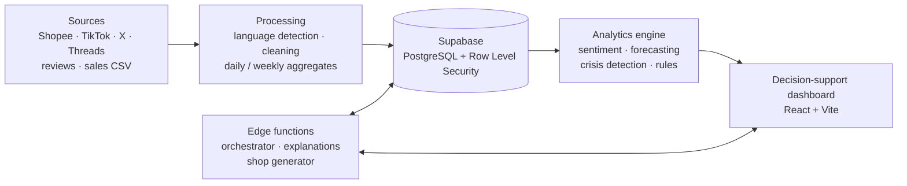

# InsightAid AI

**Decisions, backed by evidence.**

**Live demo: [insightaid-ai.vercel.app](https://insightaid-ai.vercel.app)** · demo accounts are listed on the login page.

InsightAid AI is a decision-support system for Malaysian small businesses. It reads what customers say about a business in **English, Bahasa Melayu and Mandarin**, puts that next to the business's **sales**, and turns both into **recommendations you can act on**. Each recommendation shows the evidence and the rule that produced it.

Final Year Project, Bachelor of Computer Science (Hons), Universiti Teknologi PETRONAS.
Author: Muhammad Danish Alif Bin Azrul · Supervisor: Ts. Ahmad Izuddin Bin Zainal Abidin

---

## Why it exists

Most Malaysian SMEs don't use analytics tools, so problems often show up only after sales have already dropped. The few tools that exist assume an English-speaking customer base and a dedicated data team. InsightAid AI is built for owners who:

- get feedback in **three languages**, often mixed in one sentence,
- have **little or no historical data**, especially when just starting out, and
- need **an answer to act on**, not another chart.

## Two pathways in one app

| | **Malaysian Local Shop** | **Business Startup** |
|---|---|---|
| For | A kedai, kopitiam, bakery or home business that is planning or just opened | A business already selling on Shopee, TikTok, X or Threads |
| Starts with | No data. The owner describes the business. | The owner's sales and social data |
| Shows | Break-even, margins, monthly costs, startup capital, what-if scenarios, and an AI assistant that answers in Malay or English | Sentiment by language and platform, early-warning crisis detection, revenue forecast, and evidence-based recommendations |

Both pathways share the same models and pipeline. The pathway only changes which inputs and outputs come first.

## Key features

- **Multilingual sentiment** across English, Bahasa Melayu and Mandarin.
- **Early-warning crisis detection.** A risk score computed from the business's own history, using seven signals: negative share, its rate of change, rating drops, volume anomalies and more. Each signal shows its evidence.
- **Revenue forecasting** with an uncertainty band, evaluated against simple baselines with rolling-origin validation.
- **Explainable recommendations.** They come from rules, not from an LLM. Every card shows the rule ID, the evidence that triggered it and a plain-language reason.
- **AI Business Assistant (Local Shop).** One orchestrator calls approved calculation tools and explains the result. The app computes every number. The LLM only chooses tools and words the answer, and a guard rejects any figure the tools did not produce.
- **AI shop generator.** Describe a business, and the LLM supplies starting inputs (products, prices, costs). Break-even, margins and every other figure are then calculated by the app.
- **Accessibility.** Light and dark themes, a Low-Sensory mode, reduced-motion support, and chart colours checked for contrast and colour-blind separation.

## How the AI is kept honest

> **The engine calculates, the LLM explains, and the owner decides.**

- LLM output is validated before use. Any figure an LLM tries to supply that the app should calculate is removed.
- AI-generated or illustrative content is always labelled as such in the interface.
- Recommendations come from transparent rules in [`src/utils/recommendationRules.js`](src/utils/recommendationRules.js). An optional LLM layer may only reword them.

## Architecture



| Layer | Technology |
|---|---|
| Frontend | React 19, Vite, React Router, Tailwind CSS, Recharts, Framer Motion, Lucide |
| Backend | Supabase: PostgreSQL with Row Level Security, Auth, and Deno Edge Functions |
| LLM provider | OpenAI-compatible client ([`supabase/functions/_shared/aiClient.ts`](supabase/functions/_shared/aiClient.ts)); Groq by default, Gemini as fallback |
| ML / research | Python: Hugging Face Transformers (XLM-RoBERTa, mBERT), scikit-learn, Prophet, statsmodels (ARIMA), XGBoost |
| Quality | ESLint, Vitest (565 unit tests), Playwright end-to-end and accessibility checks (axe) |

Everything used is free, open source or on a free tier. Affordability is part of the research question.

## Evaluation results

The acceptance targets were **fixed before development**. They are reported as measured, including the misses. Full details are in [`results/post_submission_2026-11/`](results/post_submission_2026-11/) and [`ml/`](ml/).

| Target | Result | Status |
|---|---|---|
| Sentiment accuracy ≥ 80% overall (XLM-R) | 84.12% on 10,769 held-out comments | Met |
| Sentiment accuracy ≥ 75% per language | EN 78.28% · BM 86.88% · ZH 94.37%; code-mixed text not evaluated | Met for the 3 languages tested |
| Forecast MAPE < 15% | 21.41% · 15.17% · 13.28% across three pre-registered protocols | Partial: met in 1 of 3 |
| Sentiment-enhanced forecast beats sales-only | Worse in 6 of 8 Diebold–Mariano tests; none significant | Not met |
| User acceptance ≥ 4.0 / 5 | 4.07 | Met overall |
| Page response < 3 s | Measured after submission: 4 of 5 pages slower (slowest median 7.1 s) | Not met |
| Chart contrast ≥ 3:1 | At submission 4 of 15 colours failed; fixed afterwards, now 15 of 15 pass in both themes | Fixed after submission |

**Two limitations, stated plainly:**

- **The live dashboard does not run XLM-R.** It uses a transparent rating-based heuristic. The trained checkpoint was lost when a Colab runtime was recycled. The reported accuracy comes from the evaluation run, documented in [`ml/sentiment/results/`](ml/sentiment/results/).
- **Adding sentiment did not improve the sales forecast** in this study. That is reported as a finding, not hidden.

## Repository structure

```
src/                 React app
  pages/             one component per route
  features/localshop Malaysian Local Shop pathway (engine, AI orchestrator, pages)
  components/        shared UI
  services/          all Supabase access (*Service.js)
  utils/             pure logic, each with a matching Vitest test
supabase/
  functions/         Edge Functions (orchestrator, explanations, shop generator, forecast)
  migrations/        database schema with Row Level Security
ml/
  sentiment/         TF-IDF baseline, mBERT, XLM-RoBERTa training and evaluation
  forecasting/       moving average, ARIMA, Prophet (±sentiment), XGBoost, rolling-origin protocol
  crisis/            crisis-detection rule and false-alarm classifier
  scenarios/         synthetic local-shop generator
e2e/                 Playwright end-to-end, accessibility and timing tests
docs/                design, data pipeline, models, deployment, audits
reports/             chart audit and dissertation figures
results/             post-submission re-test (pre-registered protocol and raw outputs)
insightaid-demo/     Remotion source for the product demo videos
DATA_CARD.md         every dataset: source, licence, size, cleaning, real vs synthetic
```

## Getting started

Requires Node.js 20.19 or later (22 recommended) and a Supabase project.

```bash
npm install
cp .env.example .env      # set VITE_SUPABASE_URL and VITE_SUPABASE_ANON_KEY
npm run dev               # http://localhost:5173
```

Apply the database schema in [`supabase/migrations/`](supabase/migrations/) and deploy the functions in [`supabase/functions/`](supabase/functions/). LLM keys (`AI_BASE_URL`, `AI_API_KEY`, `AI_MODEL`) belong in **Supabase secrets only**, never in `.env` or the frontend. See [`docs/DEPLOYMENT.md`](docs/DEPLOYMENT.md).

| Command | Purpose |
|---|---|
| `npm run dev` | Development server |
| `npm run build` | Production build |
| `npm run lint` | ESLint |
| `npm test` | Vitest unit tests |
| `npm run test:e2e` | Playwright end-to-end tests (credentials via `E2E_TEST_EMAIL` / `E2E_TEST_PASSWORD`) |

## Data and ethics

- Every dataset is listed in [`DATA_CARD.md`](DATA_CARD.md) with its source, licence and cleaning steps, and whether it is real or synthetic.
- No usernames or other personal identifiers from scraped comments are stored (PDPA 2010).
- No scraping behind logins.
- Synthetic and illustrative data is labelled wherever it appears.

## Methodology

CRISP-DM for the analytics modules, within a Design Science Research frame: build the artefact, then evaluate it against targets set in advance. Experiments use fixed random seeds, pinned library versions and logged configurations, so every reported number can be regenerated by a script in this repository.

---

© 2026 Muhammad Danish Alif Bin Azrul. All rights reserved. Developed as an academic Final Year Project at Universiti Teknologi PETRONAS.
